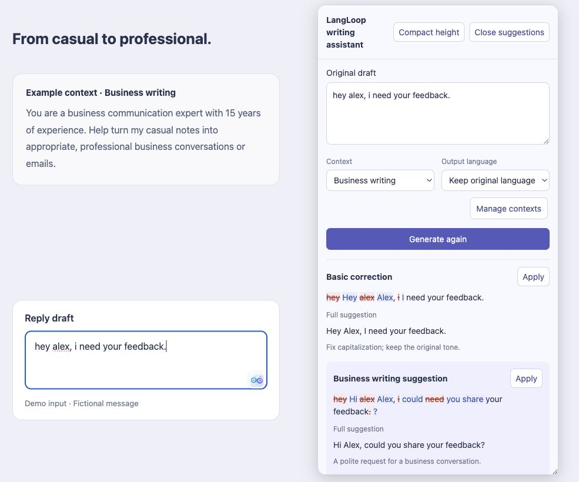
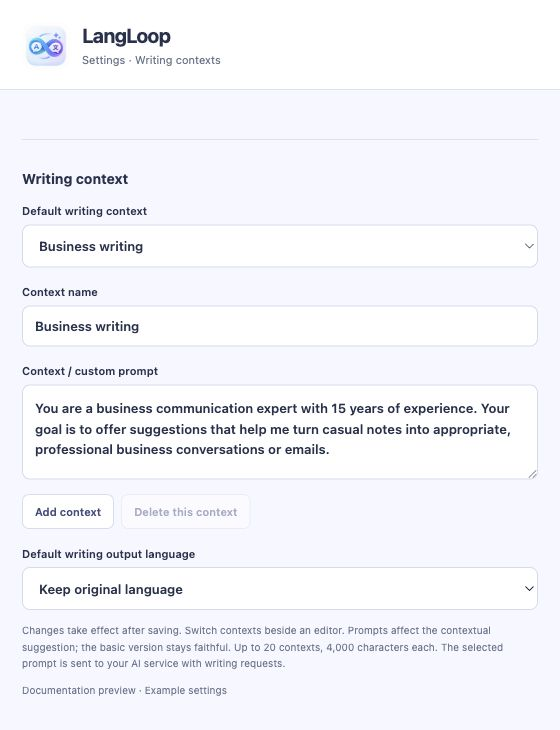

<div align="center">


# LangLoop

**Read better. Write better. Learn from both.**

An open-source Chrome extension for bilingual reading and writing help, with your own AI connection.

[繁體中文](README.zh-TW.md) · [Downloads](https://github.com/sky0926a/LangLoop/releases) · [Report an issue](https://github.com/sky0926a/LangLoop/issues)
</div>

Translate a page when you ask. Turn a Chinese draft into English, polish Chinese, or correct English directly beside your text field. Review a basic version and a context-styled suggestion before applying either. LangLoop never submits your message for you.

## See it in action

**Bilingual reading, on demand.** Click LangLoop → Translate page to keep the original text with translations below it.


Shown on OpenAI's [storage engineering article](https://openai.com/index/scaling-storage-one-billion-users-part-one/).

**Review before you apply.** Expand the writing assistant to see the original draft, word-level corrections and full suggestions together with the page's input field. Choose English to translate a Chinese draft, or keep the original language to polish it.



The business context follows a communication expert with 15 years of experience: turn casual notes into professional conversations or emails. Basic correction fixes capitalization; the contextual version changes “I need” into the polite request “could you share”.

Side-by-side documentation preview showing the input button and expanded suggestions, using the actual interface component and fixed fictional examples; no personal chats or account details. Live AI results vary with your model and context.

## Start here

**Desktop Chrome 116 or newer.** You need an AI account or API endpoint you can use. LangLoop does not require a separate local proxy, CLIProxyAPI installation, or LangLoop backend. The optional Ollama connection is for people who already run Ollama.

1. Open [Releases](https://github.com/sky0926a/LangLoop/releases) and download **`langloop-extension.zip`** under **Assets**. Do not choose GitHub's automatically generated “Source code” archives.
2. Extract the ZIP into a permanent folder, such as `Applications/LangLoop`. Keep that folder: Chrome loads the files from it.
3. Open `chrome://extensions`, turn on **Developer mode**, then choose **Load unpacked**.
4. Select the extracted folder containing **`manifest.json`**. Pin LangLoop from Chrome's extensions menu.
5. Open LangLoop → **Settings → AI connections**, set up a connection below, and choose **Save & test connection**.

No npm or terminal is required for a release download. A ZIP is not a one-click Chrome installer: unpacked installation requires the steps above. Managed browsers may prohibit Developer mode. Until a release is published, build from source using the developer steps below.

## Connect your AI

> **Login integration source: CLIProxyAPI**
>
> Some subscription login adapters are adapted from the OAuth flows, public client constants and protocol implementations of [CLIProxyAPI](https://github.com/router-for-me/CLIProxyAPI), with its [MIT license notice](licenses/CLIProxyAPI.txt) retained. These adapters run directly inside the extension: **no separate CLIProxyAPI installation or background service is required**.
>
> See [source attribution](docs/reference-analysis.md#adapted-subscription-protocols) for the adaptation scope and reference revision. This integration does not imply official authorization or endorsement by the AI providers; authorization and model availability must be checked separately for each service.

The existing connection is ready to configure. To add another, choose **New connection provider → Add account connection**. LangLoop creates `Agent 1`, `Agent 2`, etc.; rename them if useful. **Active connection** switches accounts, including multiple accounts of the same service. Each keeps its own model and login. Removal asks for confirmation.

| Connection | Setup | Current status |
|---|---|---|
| ChatGPT / Codex | Select the ChatGPT preset, click **Sign in to ChatGPT**, complete the device-code page, then return and click **Check sign-in**. Choose an available model and test. | Experimental direct subscription integration. |
| Custom OpenAI-compatible API | Enter the full API base URL (for example `https://your-provider.example/v1`), API key and model. Use **Load / refresh models** or enter the model manually. | Provider must support `/chat/completions` and the requested structured output. |
| Ollama | Select your existing local endpoint, usually `http://localhost:11434/v1`, and an installed model. | Requires your own running Ollama; not needed for other connections. |
| Claude, Antigravity, Kimi Code, Grok, Devin | Add the provider, sign in, return to check authorization, then choose or enter a model and test. If requested, paste the completed callback URL into LangLoop. | Experimental adapters; real-account authorization and inference are not yet verified for all providers. |

**“Account connected” does not mean inference works.** A successful connection test displays a real sample translation. Provider usage limits, account eligibility and charges still apply. Antigravity requires an already provisioned Google project; Devin currently requires a model UID entered manually and periodic sign-in. If a provider rejects browser authorization, no proxy fallback is started.

For Ollama origin setup, allow this extension's exact `chrome-extension://<ID>` origin using `OLLAMA_ORIGINS`; see [Ollama's OpenAI compatibility guide](https://docs.ollama.com/api/openai-compatibility). Do not expose a local model server publicly just to connect the extension.

## Use LangLoop day to day

### Read a page in two languages

Open the floating LangLoop button and choose **Translate page**, or right-click the page and choose **LangLoop: Translate page**. Original text stays visible, with translations below eligible blocks. **Stop** cancels ongoing work; **Restore original** removes completed translations.

Translation starts only after your action. Up to 200 eligible blocks are processed in batches of up to 40 blocks / 12,000 characters. The current page content is translated; automatic infinite-feed translation is not supported. Drag the floating launcher to either edge to move it.

### Write in the page's text field

1. Type in a supported input field and click its LangLoop icon.
2. Choose a **Writing context** and **Output language**:
   - **Keep original language**: correct English or polish Chinese in the same language.
   - **English**: translate a Chinese draft into English or improve an English draft.
   - **Traditional Chinese**: produce a Chinese version.
3. Click **Generate suggestions**. Review the basic correction / faithful translation and the context-styled suggestion.
4. Click **Apply** on the version you want. Same-language changes show only edited parts with strikethrough and replacements. The complete result appears below.

Edit **Original draft** inside the dialog and generate again to iterate. Applying keeps the draft and suggestions available. Changing the draft or options disables outdated Apply actions until regeneration. **Undo application** restores the previous text when the field has not been changed externally. Nothing is sent as a chat message automatically.

Drag the dialog's lower-right corner to resize its height, or use **Expand height / Compact height**. The close button stays at the top while you scroll.

### Make suggestions fit your situation

In **Settings → Writing contexts**, add a context named **Business writing**, paste the prompt below into the custom prompt field, and save. Select **Business writing** in the writing assistant and generate suggestions again.



*Settings component preview with example data.*

Copy this business-writing prompt (the same context used in the example above):

```text
You are a business communication expert with 15 years of experience. Your goal is to offer suggestions that help me turn casual notes into appropriate, professional business conversations or emails.
```

**Choose the output language separately:** select **English** to translate a Chinese draft, or **Keep original language** to correct English or polish Chinese. The context guides the business-writing suggestion; the basic correction / faithful translation remains available for comparison. Check that the result preserves your meaning before applying it.

You can also create contexts such as **Team chat** or **Friendly reply** and switch between them in the writing assistant.

### Use the side panel and learning cards

The toolbar icon opens **Assist**. Paste a draft there when an editor is unsupported, or select page text and use translation/explanation tools. Save useful results explicitly to **My learning** for local review. Cards are never saved automatically.

## Settings, privacy and limitations

Settings are separated into **General**, **AI connections**, **Writing contexts**, and **Data and privacy**. Interface language (English / Traditional Chinese) is independent of output language. General settings also let you exclude domains.

Text is sent to your selected provider when you request an AI action. Keys and login tokens stay in trusted extension-local storage, not a separately encrypted vault. Backups contain learning cards and non-secret preferences, not login tokens, API keys or the multi-account vault. See [PRIVACY.md](PRIVACY.md).

Supported surfaces include ordinary textareas and selected contenteditable / Draft.js editors. PDFs, browser-protected pages, Google Docs, embedded frames, subtitles and every possible rich editor are not supported. An icon is not shown for empty or non-editable fields. Some pages restrict injection or use unsupported editors.

## Troubleshooting

| What you see | What to try |
|---|---|
| No `manifest.json` when installing | Download the release asset, not the source archive; extract it and select the folder containing the manifest. |
| No icon after updating | Reload the extension at `chrome://extensions`, then refresh the website. Check site permissions and excluded domains. |
| “Extension context invalidated” | Refresh the page after an extension reload. Copy any unsaved draft first. |
| Login completed but translation fails | Choose a model and run **Save & test connection**. Authorization and model access are separate. |
| Model list is empty | Retry **Load / refresh models**, or enter a model actually available to your account. |
| A page or text field is unsupported | Select text or paste it into Assist. Do not assume every editor is compatible. |

## Update without losing local data

1. Export a backup in **Settings → Data and privacy**.
2. Replace the extracted extension files with the new release **at the same location**.
3. Reload LangLoop at `chrome://extensions`, then refresh open web pages.

Keep the manifest identity key unchanged. Do not uninstall as an update step: uninstalling removes extension-local data. If moving to a new installation, import your backup and reconnect accounts. Unpacked installations do not update automatically.

## Build and contribute

Node.js 22.15+ and npm:

```sh
npm ci
npx playwright install chromium
npm run lint
npm run typecheck
npm test
npm run package
npm run test:e2e
```

Load `dist/extension/` in Chrome. `dist/langloop-extension.zip` is the installable unpacked package. Tests use synthetic drafts and mock providers; see [verification boundaries](docs/verification.md).

The [release workflow](.github/workflows/release.yml) runs checks, packages the extension and produces a ZIP plus SHA-256 checksums. Version tags create a **draft** GitHub Release after checks pass; manual runs provide Actions artifacts. See [Release guide](docs/releases.md) for the exact process. These workflows take effect only after they are pushed to GitHub.

Keep credentials, browser profiles, local specifications and generated artifacts out of Git. The committed `public/identity.txt` is a public extension identity key, not a private signing key. Regenerate dependency attribution with `node scripts/notices.mjs` after dependency changes.

## License and acknowledgments

LangLoop is [Apache-2.0](LICENSE). Bundled components retain their own licenses in [THIRD_PARTY_NOTICES.txt](THIRD_PARTY_NOTICES.txt).

See [Source attribution](docs/reference-analysis.md) for implementation references and adapted protocols.
