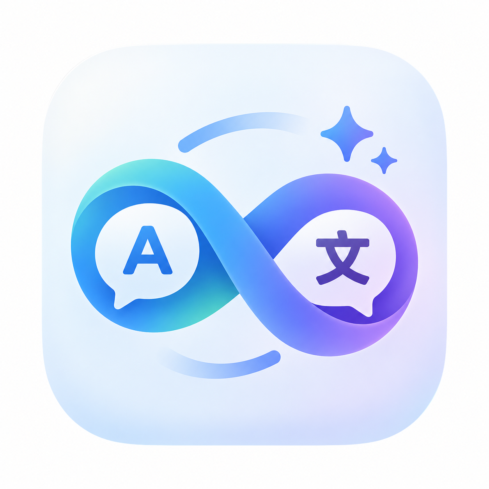
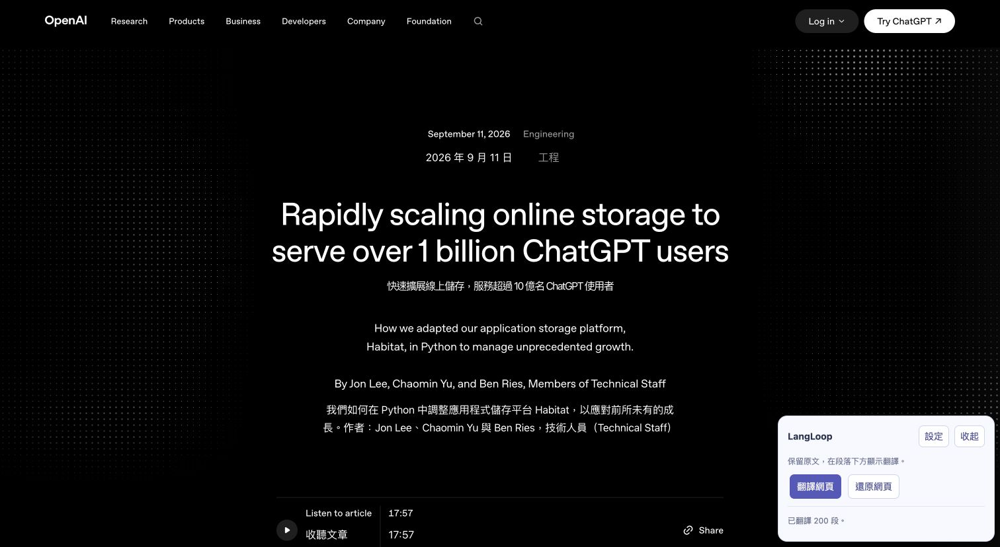
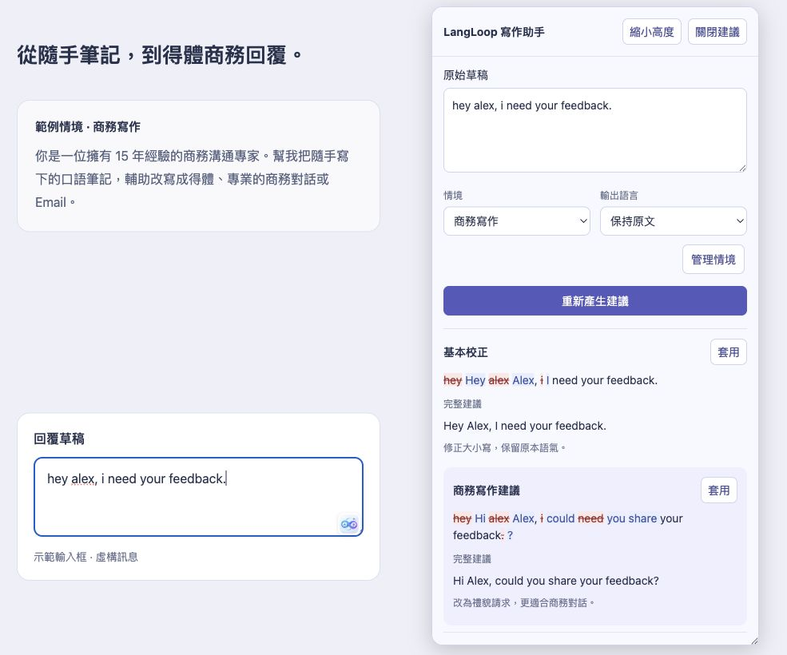
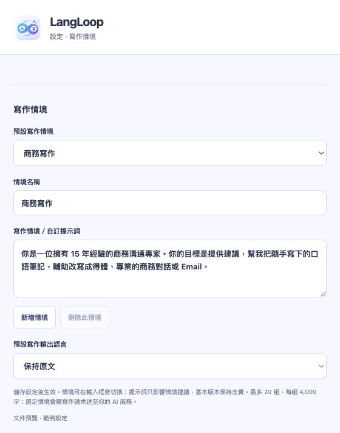

<div align="center">


# LangLoop

**讀得更懂，寫得更好，從兩者持續學習。**

在網頁上翻譯文章、校正英文、潤飾中文，並使用自己的 AI 連線。

[English](README.md) · [下載版本](https://github.com/sky0926a/LangLoop/releases) · [回報問題](https://github.com/sky0926a/LangLoop/issues)
</div>

LangLoop 把雙語閱讀與寫作建議放在你正在使用的網頁上。每次產生建議都由你按下按鈕；先看基本校正／忠實翻譯，再參考情境改寫，自行決定套用哪一個版本，不會自動送出聊天訊息。

## 實際操作畫面

**需要時才啟動雙語閱讀。** 按 LangLoop → 翻譯網頁，保留原文，在下方顯示譯文。



示範頁面為 OpenAI 的[儲存系統技術文章](https://openai.com/index/scaling-storage-one-billion-users-part-one/)。

**先看建議，再決定套用。** 展開寫作助手，在同一張畫面查看原始草稿、刪除線校正與完整建議，並保留網頁輸入框。中文草稿可選「英文」翻譯，或選「保持原文」潤飾中文。



範例採用「15 年經驗的商務溝通專家」情境，將口語筆記轉為得體的商務對話或 Email。基本校正只修大小寫；商務建議則把直接的「I need」改為較禮貌的「could you share」。

此圖以左右並列方式展示輸入框按鈕與展開建議，使用實際介面元件與固定虛構範例製作文件預覽，不含個人對話或帳號資料；實際 AI 結果會隨模型與情境不同。

## 安裝：下載、解壓、載入 Chrome

需要桌面版 Chrome 116 以上，以及可使用的 AI 帳號或 API。使用訂閱登入或遠端 API 不必另外安裝 CLIProxyAPI、啟動本機服務或註冊 LangLoop 帳號。Ollama 是供已有本機模型服務的使用者選用。

1. 前往 [GitHub Releases](https://github.com/sky0926a/LangLoop/releases)，在 **Assets** 下載 **`langloop-extension.zip`**。不要選 GitHub 自動提供的 **Source code** 原始碼壓縮檔。
2. 解壓到固定資料夾，例如 `Applications/LangLoop`。Chrome 會持續讀取它，安裝後不要刪除。
3. 開啟 `chrome://extensions`，啟用右上角的 **開發人員模式**。
4. 按 **載入未封裝項目**，選擇內含 **`manifest.json`** 的資料夾。
5. 在 Chrome 的擴充功能選單釘選 LangLoop，開啟 **設定 → AI 連線**，完成下方設定並按 **儲存並測試連線**。

使用 Release 成品不需要 Node.js、npm 或終端機。ZIP 仍需解壓並手動載入，不能雙擊就完成 Chrome 安裝；公司管理的 Chrome 可能禁止開發人員模式。若尚未發布 Release，請依本文末尾的方式自行建置。

## 第一次設定 AI

> **登入接口來源：CLIProxyAPI**
>
> 部分訂閱登入接口改寫自開源專案 [CLIProxyAPI](https://github.com/router-for-me/CLIProxyAPI) 的 OAuth 流程、公開用戶端常數與協定實作，並保留其 [MIT 授權聲明](licenses/CLIProxyAPI.txt)。這些接口直接在擴充功能中執行，**不需要另外安裝或啟動 CLIProxyAPI 背景服務**。
>
> 改寫範圍與參考版本見[來源說明](docs/reference-analysis.md#adapted-subscription-protocols)。此整合不代表相關 AI 服務商的官方授權或背書；各服務的登入與模型可用性仍須分別確認。

你可以直接設定現有連線；要增加帳號，先選 **新增連線的服務**，再按 **新增帳號連線**。系統自動產生 `Agent 1`、`Agent 2` 等名稱，之後可以重新命名。

在 **目前使用的連線** 切換帳號。同一服務可保留多個帳號，每個帳號有自己的模型與登入資料；新增不會覆蓋其他帳號，移除前會再次確認。

| 連線方式 | 設定方法 | 注意事項 |
|---|---|---|
| ChatGPT／Codex | 選 ChatGPT，按登入，在開啟的授權頁輸入 LangLoop 顯示的代碼；完成後回來按檢查登入，再選模型並測試。 | 直接訂閱登入為實驗性功能。若服務要求，需先在帳號開啟裝置代碼登入。 |
| 自訂 OpenAI-compatible API | 填入包含 API 前綴的網址，例如 `https://your-provider.example/v1`，以及 API key、模型。可載入模型清單或手動輸入。 | 服務需支援 `/chat/completions` 與指定的結構化輸出；計費依服務商。 |
| Ollama | 使用你已啟動的 Ollama，通常是 `http://localhost:11434/v1`，填入已安裝的模型名稱。 | 此選項需要自己的 Ollama；其他連線不需要本機服務。 |
| Claude、Antigravity、Kimi Code、Grok、Devin | 新增對應服務，登入後回來檢查授權，再選擇或輸入模型並測試；有提示時貼上授權完成的回呼網址。 | 實驗性接口，尚未逐一完成真實帳號授權與推論驗證。 |

**顯示「已連線」不等於模型一定能用。** 請執行連線測試，成功時會顯示實際的範例翻譯。帳號資格、使用限制與費用依服務商而定。Antigravity 需要已完成開通的 Google 專案；Devin 目前需要手動輸入模型 UID，並可能重新登入。服務若拒絕瀏覽器授權，不會替你另開代理服務。

若 Ollama 拒絕來源，依 [官方設定說明](https://docs.ollama.com/api/openai-compatibility)，使用 `OLLAMA_ORIGINS` 允許這個擴充功能的確切來源 `chrome-extension://<ID>`。不必為此把本機服務暴露到公網。

## 日常怎麼用

### 整頁雙語閱讀

點開網頁旁的 LangLoop 浮動按鈕，再按 **翻譯網頁**；也可以在網頁按右鍵，選 **LangLoop：翻譯整頁**。原文保留，譯文顯示在符合條件的文字區塊下方。

- **停止**：中止正在進行的工作，已完成的譯文保留。
- **還原網頁**：取消工作並移除 LangLoop 加入的譯文。
- 浮動入口可以拖到左右兩側，收起時靠邊停放。

不會因為開啟頁面就自動送出翻譯。每頁最多擷取 200 個符合條件的區塊，每批最多 40 個區塊／12,000 字元；速度取決於模型。自動翻譯無限捲動後的新內容尚未支援。

### 在輸入框旁修正或翻譯

1. 在支援的輸入框打字，點框內的 LangLoop 圖示。
2. 選擇 **情境** 與 **輸出語言**：
   - **保持原文**：英文校正，或中文潤飾。
   - **英文**：中文翻成英文，或改善原本的英文。
   - **繁體中文**：產生中文版本。
3. 按 **產生建議**，比較基本校正／忠實翻譯與情境建議。
4. 在想使用的版本旁按 **套用**。同語言校正僅劃掉有修改的部分，旁邊顯示替換文字，下方保留完整建議。

可在視窗的 **原始草稿** 繼續修改，再按 **重新產生建議**。套用後草稿與建議仍保留，網站輸入框只有在你按套用時才會被改動。修改草稿或選項後，舊建議仍可參考，但要重新產生才能再套用。**復原套用** 會在輸入框沒有被其他操作改動時還原先前文字。

拖曳視窗**右下角**調整高度，或按 **展開高度／縮小高度**。內容可內部捲動，關閉按鈕固定在頂部。

### 建立自己的寫作情境

到 **設定 → 寫作情境設定**，按 **新增情境**，將名稱設為「商務寫作」，把下方 prompt 貼入 **寫作情境／自訂提示詞** 並儲存。回到寫作助手後，選擇「商務寫作」並重新產生建議。



*使用範例資料的設定元件預覽。*

可直接複製的商務寫作 prompt（與上方示範相同的情境）：

```text
你是一位擁有 15 年經驗的商務溝通專家。你的目標是提供建議，幫我把隨手寫下的口語筆記，輔助改寫成得體、專業的商務對話或 Email。
```

**輸出語言另外選擇**：「英文」可將中文草稿翻成英文；「保持原文」可校正英文或潤飾中文。情境提示詞引導商務寫法，基本校正／忠實翻譯仍可作為對照，套用前請確認內容符合原意。

也可以建立「同事聊天」、「日常回覆」等多組情境，在寫作助手中切換。

### 側邊欄與學習卡片

Chrome 工具列的 LangLoop 圖示會開啟 **Assist**。輸入框不支援時，可將草稿貼到這裡；選取網頁文字後也可以使用翻譯與解釋工具。手動儲存值得記住的結果，到 **My learning** 查看與複習，系統不會自動建立學習卡片。

## 設定與隱私

設定分成一般、AI 連線、寫作情境、資料與隱私。介面可選繁體中文或英文，與翻譯／寫作輸出語言分開；也能設定不啟用的網域。

只有你要求 AI 操作時，相關文字才會送到所選服務。API key 與登入 token 儲存在 Chrome 擴充功能的本機儲存空間，不是額外加密的密碼保管庫。備份包含學習卡片與非機密偏好設定，**不包含 API key、登入 token 或多帳號連線資料庫**。詳見 [隱私說明](PRIVACY.md)。

目前支援一般 textarea 與部分 contenteditable／Draft.js 編輯器。PDF、Chrome 保護頁面、Google Docs、內嵌框架、字幕與所有富文字編輯器尚未支援。空白或不可編輯的輸入框不會顯示圖示。

## 常見問題

| 問題 | 處理方式 |
|---|---|
| 找不到 `manifest.json` | 請下載 Release 的成品 ZIP，解壓後選內含 manifest 的資料夾，不是原始碼 ZIP。 |
| 更新後沒有浮動按鈕 | 重新載入擴充功能，再重新整理網頁，並檢查網站權限與排除網域。 |
| 顯示 Extension context invalidated | 擴充功能更新後需重新整理網頁；先複製尚未儲存的草稿。 |
| 登入成功，但不能翻譯 | 確認模型可用，執行「儲存並測試連線」，依顯示的錯誤處理。 |
| 模型清單空白 | 重新載入清單，或手動填入帳號實際可用的模型。 |
| 某個公司的輸入框沒有圖示 | 該編輯器可能不支援，先使用側邊欄 Assist，回報問題時請勿附私人訊息或憑證。 |

## 更新與備份

1. 在 **設定 → 資料與隱私** 匯出備份。
2. 將新版 ZIP 解壓後的檔案替換到**原本的安裝資料夾**。
3. 在 `chrome://extensions` 重新載入 LangLoop，再重新整理使用中的網頁。

不要以解除安裝作為更新步驟：解除安裝會刪除本機資料。保留 manifest 的公開識別 key；換到新的安裝環境時，匯入備份後需重新設定帳號。手動載入版不會自動更新。

## 開發與自動發佈

開發者需要 Node.js 22.15+ 與 npm：

```sh
npm ci
npx playwright install chromium
npm run lint
npm run typecheck
npm test
npm run package
npm run test:e2e
```

Chrome 可載入 `dist/extension/`；提供給使用者的是 `dist/langloop-extension.zip`。測試使用合成文字與模擬服務，不代表所有真實帳號都已驗證。詳見 [驗證範圍](docs/verification.md)。

已提供 [GitHub Actions 工作流程](.github/workflows/release.yml)：測試通過後自動產生 ZIP、SHA-256 校驗碼與安裝說明。推送版本標籤會建立 **Release 草稿**，維護者檢查後再發布；手動執行則產生 Actions artifact。操作方式見 [Release guide](docs/releases.md)。工作流程需推送到 GitHub 後才會啟用，目前文件與流程設定不代表已有可下載的正式版本。

## 授權與參考來源

LangLoop 採用 [Apache-2.0](LICENSE)，第三方授權聲明見 [THIRD_PARTY_NOTICES.txt](THIRD_PARTY_NOTICES.txt)。

實作參考與協定改寫資訊見[來源說明](docs/reference-analysis.md)。
